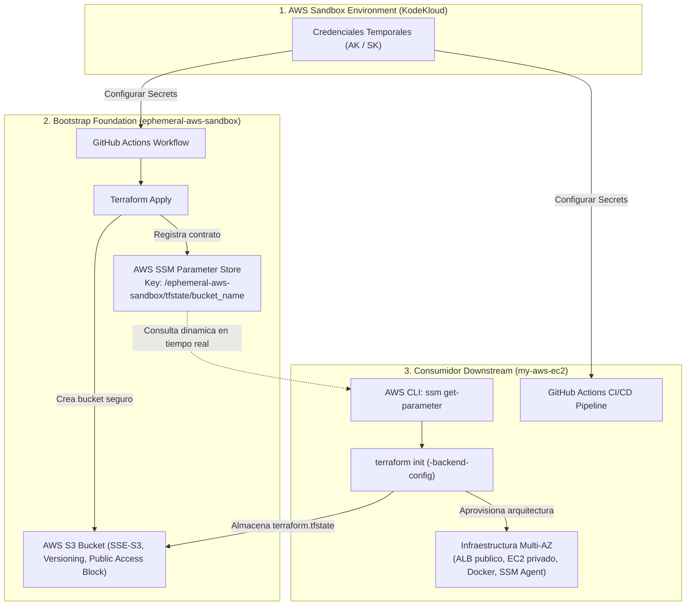

# Ephemeral AWS Sandbox State Bucket (Bootstrap Foundation)

[](https://www.terraform.io/)
[](https://aws.amazon.com/)
[](https://github.com/features/actions)

Capa base (**Bootstrap Foundation**) para entornos de AWS efímeros (como KodeKloud Playgrounds o sandboxes temporales). Su responsabilidad principal es aprovisionar el backend remoto de Terraform (S3 bucket para `tfstate`) bajo las mejores prácticas de seguridad y exponer su identificador a través de **AWS Systems Manager (SSM) Parameter Store**, permitiendo que repositorios downstream consuman el estado remoto de forma **100% automatizada, desacoplada y sin intervención manual**.

---

## 📌 Tabla de Contenidos

- [Contexto y Propósito (Bootstrap Foundation)](#-contexto-y-propósito-bootstrap-foundation)
- [Diagrama de Arquitectura e Integración](#-diagrama-de-arquitectura-e-integración)
- [Contrato de Integración (SSM Parameter Store)](#-contrato-de-integración-ssm-parameter-store)
- [Proyecto Consumidor Downstream: my-aws-ec2](#-proyecto-consumidor-downstream-my-aws-ec2)
- [Recursos y Mejores Prácticas de Seguridad](#-recursos-y-mejores-prácticas-de-seguridad)
- [Estrategia de Autenticación: Sandbox vs. Roadmap OIDC](#-estrategia-de-autenticación-sandbox-vs-roadmap-oidc)
- [Variables y Secretos](#-variables-y-secretos)
- [Guía de Despliegue](#-guía-de-despliegue)
- [Uso Local Opcional](#-uso-local-opcional)
- [Estructura del Proyecto](#-estructura-del-proyecto)

---

## 🎯 Contexto y Propósito (Bootstrap Foundation)

En entornos de laboratorio y sandboxes de AWS de corta duración (por ejemplo, **KodeKloud Playgrounds**), las cuentas son creadas bajo demanda y tienen un ciclo de vida limitado (horas). Al iniciar cada sesión:
- Se asigna una cuenta de AWS limpia con credenciales temporales (`AWS_ACCESS_KEY_ID` y `AWS_SECRET_ACCESS_KEY`).
- Los proyectos de infraestructura posteriores necesitan un lugar seguro donde persistir su estado (`terraform.tfstate`).
- Configurar manualmente el nombre del bucket en cada repositorio consumidor ralentiza las pruebas y genera fricción propensa a errores humanos.

### Rol de este repositorio
Este repositorio resuelve el problema del *huevo y la gallina* actuando como la **Capa 0 (Bootstrap Layer)**:
1. Crea un **S3 Bucket único** para alojar estados de Terraform con cifrado, versionado y bloqueo estricto de acceso público.
2. Registra el nombre del bucket en **AWS Systems Manager Parameter Store** bajo una clave estándar:
   ```text
   /ephemeral-aws-sandbox/tfstate/bucket_name
   ```
3. Actúa como el **Service Discovery** de backend para cualquier repositorio consumidor, habilitando pipelines de CI/CD totalmente autónomos.

> ℹ️ **¿Por qué este repositorio no tiene backend remoto propio?**  
> Al ser la infraestructura raíz que da origen al almacenamiento de estado en una cuenta efímera, este repositorio no necesita persistir su propio archivo `.tfstate`. La cuenta y todos sus recursos se destruyen automáticamente al expirar la sesión del laboratorio.

---

## ⚡ Diagrama de Arquitectura e Integración

El siguiente diagrama ilustra cómo este repositorio sirve de base para habilitar el despliegue desacoplado y desatendido de infraestructuras downstream:



---

## 📋 Contrato de Integración (SSM Parameter Store)

El desacoplamiento entre este repositorio bootstrap y los proyectos consumidores se basa en un contrato formal definido en **AWS Systems Manager (SSM) Parameter Store**:

| Atributo | Valor / Especificación |
| :--- | :--- |
| **Nombre del Parámetro (Key)** | `/ephemeral-aws-sandbox/tfstate/bucket_name` |
| **Tipo** | `String` |
| **Valor almacenado** | Nombre del bucket S3 generado dinámicamente (`<owner>-bucket-state-<unix_timestamp>`) |
| **Permisos mínimos requeridos** | `ssm:GetParameter` en la región correspondiente |

### Cómo consumirlo desde la AWS CLI:
```bash
BUCKET=$(aws ssm get-parameter \
  --name "/ephemeral-aws-sandbox/tfstate/bucket_name" \
  --query "Parameter.Value" \
  --output text)
```

---

## 🔗 Proyecto Consumidor Downstream: `my-aws-ec2`

Este repositorio sirve como base directa para el proyecto:
- **Repositorio:** [**my-aws-ec2**](https://github.com/diegofeversani/my-aws-ec2) (`https://github.com/diegofeversani/my-aws-ec2`)
- **Descripción:** Despliega una arquitectura Multi-AZ segura y de alta disponibilidad compuesta por una VPC personalizada, un Application Load Balancer (ALB) público y una instancia EC2 en subred privada con Docker preinstalado, gestionada íntegramente a través de **AWS SSM Session Manager** (sin exponer puertos SSH ni requerir bastion hosts).

### Integración en el Pipeline de CI/CD de `my-aws-ec2`:
En el flujo de GitHub Actions de `my-aws-ec2`, el backend de Terraform se declara vacío (`backend "s3" {}`) y se configura dinámicamente consultando el parámetro SSM en tiempo real:

```yaml
- name: Configure AWS Credentials
  uses: aws-actions/configure-aws-credentials@v4
  with:
    aws-access-key-id: ${{ secrets.AWS_ACCESS_KEY_ID }}
    aws-secret-access-key: ${{ secrets.AWS_SECRET_ACCESS_KEY }}
    aws-region: ${{ vars.REGION }}

- name: Terraform Init (Automático vía SSM)
  run: |
    # 1. Recuperar el nombre del bucket desde SSM Parameter Store
    BUCKET=$(aws ssm get-parameter --name "/ephemeral-aws-sandbox/tfstate/bucket_name" --query "Parameter.Value" --output text)
    
    # 2. Inicializar el backend S3 con aislamiento por nombre de repositorio
    terraform init \
      -backend-config="bucket=$BUCKET" \
      -backend-config="key=${{ github.event.repository.name }}/terraform.tfstate" \
      -backend-config="region=${{ vars.REGION }}"
```

> 💡 **Aislamiento de estados:** Al utilizar `${{ github.event.repository.name }}` como prefijo en la `key` del backend, múltiples repositorios o proyectos pueden coexistir en el mismo bucket S3 sin riesgo de colisión o sobreescritura de estado.

---

## 🛡 Recursos y Mejores Prácticas de Seguridad

La configuración de Terraform implementa las siguientes defensas en profundidad:

1. **Bloqueo Total de Acceso Público (`aws_s3_bucket_public_access_block`)**:
   - `block_public_acls = true`
   - `block_public_policy = true`
   - `ignore_public_acls = true`
   - `restrict_public_buckets = true`  
   Garantiza que ningún estado de Terraform ni dato sensible pueda exponerse a internet.

2. **Cifrado en Reposo (`aws_s3_bucket_server_side_encryption_configuration`)**:
   - Algoritmo `AES256` (SSE-S3) habilitado de forma predeterminada para todos los objetos.

3. **Versionado de Objetos (`aws_s3_bucket_versioning`)**:
   - Estado `Enabled`, permitiendo auditoría y recuperación ante modificaciones accidentales del estado de Terraform.

4. **Nombres Únicos sin Colisiones (`time_static`)**:
   - Emplea el proveedor `hashicorp/time` para fijar un timestamp Unix estático durante la creación, asegurando nombres globalmente únicos en AWS S3 sin alterar el plan en ejecuciones consecutivas.

5. **Parámetro SSM Descriptivo (`aws_ssm_parameter`)**:
   - Expone `/ephemeral-aws-sandbox/tfstate/bucket_name` etiquetado con entorno y propietario.

---

## 🔐 Estrategia de Autenticación: Sandbox vs. Roadmap OIDC

### Estado Actual: Credenciales Temporales de Sandbox
En plataformas de entrenamiento y laboratorios como **KodeKloud AWS Playgrounds**:
- Se aprovisionan cuentas aisladas y de muy corta duración (1 a 4 horas).
- Las credenciales IAM entregadas son pares estáticos efímeros (`AWS_ACCESS_KEY_ID` y `AWS_SECRET_ACCESS_KEY`).
- En este escenario, la práctica más directa y viable es cargar estas credenciales temporales en los **GitHub Secrets** al iniciar la sesión de práctica.

### Visión Futura / Roadmap: Migración a GitHub OIDC
Para entornos en cuentas fijas, cuentas corporativas o entornos de staging/producción:
- **Objetivo:** Eliminar por completo el almacenamiento de credenciales estáticas de larga duración en GitHub Secrets.
- **Implementación:** Configurar federación de identidades mediante **OpenID Connect (OIDC)** entre GitHub Actions y AWS IAM.
- **Flujo:** GitHub Actions asume un IAM Role con privilegios acotados (`aws-actions/configure-aws-credentials` con `role-to-assume` y `role-session-name`), validando el token criptográfico emitido por GitHub mediante un `Identity Provider` OIDC en AWS.

---

## ⚙️ Variables y Secretos

Configura los siguientes valores en el repositorio (**Settings > Secrets and variables > Actions**):

### 🔑 Secretos (Secrets)
| Secreto | Descripción |
| :--- | :--- |
| `AWS_ACCESS_KEY_ID` | Access Key de la sesión del sandbox. |
| `AWS_SECRET_ACCESS_KEY` | Secret Key de la sesión del sandbox. |

### 📋 Variables de Configuración (Variables)
| Variable | Descripción | Valor sugerido |
| :--- | :--- | :--- |
| `REGION` | Región de AWS del sandbox | `us-east-1` |
| `OWNER` | Alias o prefijo de recursos | `fvrsn` |
| `ENVIRONMENT` | Etiqueta del entorno | `sandbox` |
| `TF_VERSION` | Versión de Terraform para el runner | `1.7.0` |

---

## 🚀 Guía de Despliegue

1. **Actualizar credenciales:** Al iniciar una sesión de sandbox en KodeKloud, copia la Access Key y Secret Key en los Secrets de GitHub (`AWS_ACCESS_KEY_ID` y `AWS_SECRET_ACCESS_KEY`).
2. **Ejecutar el Pipeline:**
   - Ve a la pestaña **Actions** en GitHub.
   - Selecciona el workflow **"Terraform Deployment"**.
   - Haz clic en **Run workflow** sobre la rama `main`.
3. **Verificar el Step Summary:**
   - Una vez finalizado el trabajo, el resumen del workflow imprimirá el nombre del bucket generado y el comando exacto para consultarlo vía SSM.
4. **Desplegar repositorios downstream:**
   - Ya puedes disparar los workflows de tus proyectos consumidores (como `my-aws-ec2`), los cuales leerán el parámetro SSM automáticamente.

---

## 💻 Uso Local Opcional

Si deseas interactuar con Terraform desde tu terminal local:

1. Ingresa al directorio de Terraform:
   ```bash
   cd terraform
   ```
2. Crea tu archivo de variables locales:
   ```bash
   cp terraform.tfvars.example terraform.tfvars
   ```
3. Inicializa y aplica los cambios:
   ```bash
   terraform init
   terraform apply
   ```
4. Verifica la lectura del parámetro SSM:
   ```bash
   aws ssm get-parameter --name "/ephemeral-aws-sandbox/tfstate/bucket_name" --query "Parameter.Value" --output text
   ```

---

## 📂 Estructura del Proyecto

```text
.
├── .github/
│   └── workflows/
│       └── terraform-deploy.yml   # CI/CD: Terraform Apply y publicación en GitHub Step Summary
├── terraform/                     # Código de infraestructura Terraform
│   ├── main.tf                    # S3 Bucket, Block Public Access, Versioning, SSE y SSM Parameter
│   ├── providers.tf               # Declaración de proveedores (AWS >= 6.0, Time >= 0.10)
│   ├── variables.tf               # Definición de variables de entrada
│   ├── outputs.tf                 # Outputs exportados (bucket_name, bucket_arn, ssm_parameter_name)
│   ├── time.tf                    # Recurso time_static para garantizar unicidad
│   └── terraform.tfvars.example   # Plantilla de variables para pruebas locales
└── README.md                      # Documentación arquitectónica y de integración
```
