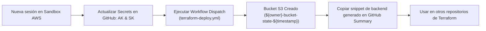

# Ephemeral AWS Sandbox State Bucket

Bootstrap de infraestructura con **Terraform** y **GitHub Actions** para aprovisionar un **Bucket S3 efímero**, diseñado específicamente para almacenar el estado remoto (`backend "s3"`) de Terraform de otros repositorios en cuentas temporales/sandbox de AWS.

---

## 📌 Tabla de Contenidos

- [Contexto y Propósito](#-contexto-y-propósito)
- [Cómo Funciona el Flujo](#-cómo-funciona-el-flujo)
- [Recursos Creados](#-recursos-creados)
- [Variables y Secretos](#-variables-y-secretos)
- [Uso con GitHub Actions (Workflow Dispatch)](#-uso-con-github-actions-workflow-dispatch)
- [Cómo Usar el Bucket en tus Otros Repos](#-cómo-usar-el-bucket-en-tus-otros-repos)
- [Uso Local Opcional](#-uso-local-opcional)
- [Estructura del Proyecto](#-estructura-del-proyecto)

---

## 🎯 Contexto y Propósito

En entornos sandbox de AWS (laboratorios temporales, cuentas de práctica o sandboxes corporativos), las credenciales de acceso (**Access Key** y **Secret Key**) son de corta duración y se renuevan con frecuencia al iniciar cada sesión.

Este repositorio resuelve la necesidad de inicializar rápidamente el **almacenamiento de estado remoto**:
1. Cada vez que inicias un sandbox, actualizas los secretos en GitHub (`AWS_ACCESS_KEY_ID` y `AWS_SECRET_ACCESS_KEY`).
2. Disparas el workflow manualmente vía **`workflow_dispatch`**.
3. Terraform crea un bucket S3 único con versionado y cifrado.
4. GitHub Actions te muestra en el resumen de ejecución el snippet exacto de `backend "s3"` para copiar y pegar en tus otros repositorios de infraestructura.

> ℹ️ **¿Por qué este repo no tiene backend remoto propio?**  
> Al tratarse del *bootstrap* inicial en una cuenta sandbox efímera, este repositorio crea el recurso raíz (el bucket de estado). No necesita persistir su propio estado entre sesiones porque la cuenta sandbox se destruye o reinicia al expirar el laboratorio.

---

## ⚡ Cómo Funciona el Flujo



---

## 🛠 Recursos Creados

- **HashiCorp Time Provider (`time_static`)**: Genera una marca de tiempo Unix estática (`${time_static.this.unix}`) para asegurar un nombre de bucket S3 único y sin colisiones en AWS.
- **AWS S3 Bucket**: Creado bajo el nombre `${var.owner}-bucket-state-${time_static.this.unix}` y etiquetado con `Environment` y `Owner`.
- **S3 Bucket Versioning**: Habilitado (requisito y buena práctica para backend de Terraform).
- **S3 Server-Side Encryption (SSE)**: Encriptación automática por defecto con algoritmo `AES256`.

---

## ⚙️ Variables y Secretos

Configura los siguientes valores en tu repositorio de GitHub (**Settings > Secrets and variables > Actions**):

### 🔐 Secretos (Secrets)
Actualiza estos valores cada vez que inicies una nueva sesión en tu sandbox:

| Secreto | Descripción |
| :--- | :--- |
| `AWS_ACCESS_KEY_ID` | Access Key temporal provista por tu entorno sandbox. |
| `AWS_SECRET_ACCESS_KEY` | Secret Key temporal provista por tu entorno sandbox. |

### 📋 Variables de Configuración (Variables)
Valores fijos para tus despliegues:

| Variable | Descripción | Valor sugerido |
| :--- | :--- | :--- |
| `REGION` | Región de AWS de la cuenta sandbox | `us-east-1` |
| `OWNER` | Tu alias, prefijo o nombre | `fvrsn` |
| `ENVIRONMENT` | Etiqueta del entorno | `sandbox` |
| `TF_VERSION` | Versión de Terraform en GitHub Actions | `1.7.0` (o `latest`) |

---

## 🚀 Uso con GitHub Actions (Workflow Dispatch)

Cada vez que comiences un laboratorio o renueves credenciales de tu sandbox:

1. Ve a **Settings > Secrets and variables > Actions > Secrets** y actualiza `AWS_ACCESS_KEY_ID` y `AWS_SECRET_ACCESS_KEY`.
2. Dirígete a la pestaña **Actions** en GitHub.
3. En el menú izquierdo selecciona **"Terraform Deployment"**.
4. Haz clic en **Run workflow** sobre la rama `main`.
5. Al finalizar el job, abre el resumen (**Summary**) de la ejecución: verás el nombre del bucket creado y el bloque de código listo para copiar.

### 🧹 Destrucción al terminar la sesión (Opcional)
Si deseas limpiar los recursos antes de que expire la cuenta sandbox:
1. En la pestaña **Actions**, selecciona **"Terraform Destroy"**.
2. Haz clic en **Run workflow**.

---

## 📋 Cómo Usar el Bucket en tus Otros Repos

En cualquiera de tus otros repositorios de Terraform que corran contra la misma cuenta sandbox, agrega el bloque de backend en tu archivo de proveedores:

```hcl
terraform {
  backend "s3" {
    bucket = "fvrsn-bucket-state-1794330043" # El nombre generado por el workflow
    key    = "mi-proyecto/terraform.tfstate"
    region = "us-east-1"
  }
}
```

---

## 💻 Uso Local Opcional

Si prefieres ejecutarlo desde tu terminal con credenciales locales:

1. Copia la plantilla de variables:
   ```bash
   cp terraform.tfvars.example terraform.tfvars
   ```
2. Edita `terraform.tfvars` con tus credenciales temporales.
3. Ejecuta:
   ```bash
   terraform init
   terraform apply
   ```
4. Para destruir el bucket:
   ```bash
   terraform destroy
   ```

*(El archivo `terraform.tfvars` está protegido en `.gitignore` para no subir credenciales).*

---

## 📂 Estructura del Proyecto

```text
.
├── .github/
│   └── workflows/
│       ├── terraform-deploy.yml   # Despliegue (push / workflow_dispatch) + Step Summary
│       └── terraform-destroy.yml  # Destrucción bajo demanda (workflow_dispatch)
├── main.tf                        # Bucket S3, versionado y cifrado SSE
├── providers.tf                   # Proveedores AWS y Time
├── variables.tf                   # Variables de entrada y credenciales
├── outputs.tf                     # Exporta el bucket_name
├── time.tf                        # Timestamp estático para nombres únicos
├── terraform.tfvars.example       # Plantilla de variables para uso local
└── README.md
```
