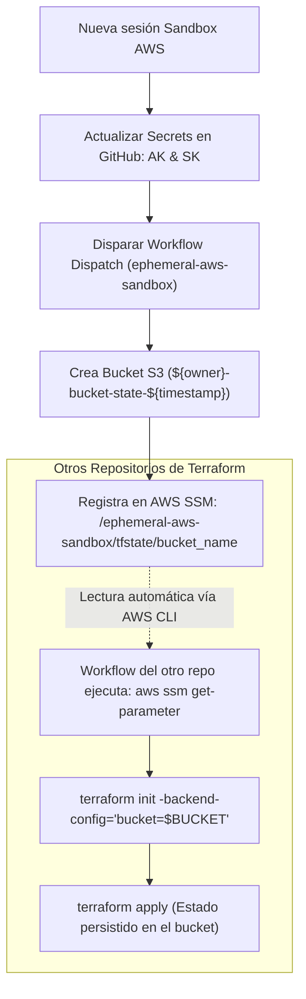

# Ephemeral AWS Sandbox State Bucket

Bootstrap de infraestructura con **Terraform** y **GitHub Actions** para aprovisionar un **Bucket S3 efímero** y registrar su nombre en **AWS SSM Parameter Store**, permitiendo que otros repositorios consuman el estado remoto (`backend "s3"`) de forma **100% automática y sin copiar ni pegar**.

---

## 📌 Tabla de Contenidos

- [Contexto y Propósito](#-contexto-y-propósito)
- [Cómo Funciona el Flujo Automático](#-cómo-funciona-el-flujo-automático)
- [Recursos Creados](#-recursos-creados)
- [Variables y Secretos](#-variables-y-secretos)
- [Uso con GitHub Actions (Workflow Dispatch)](#-uso-con-github-actions-workflow-dispatch)
- [Consumo Automático desde Otros Repositorios](#-consumo-automático-desde-otros-repositorios)
- [Uso Local Opcional](#-uso-local-opcional)
- [Estructura del Proyecto](#-estructura-del-proyecto)

---

## 🎯 Contexto y Propósito

En entornos sandbox de AWS (laboratorios temporales o sandboxes de prueba), las credenciales (**Access Key** y **Secret Key**) son de corta duración y se renuevan al iniciar cada sesión.

Este repositorio actúa como el **bootstrap inicial** del sandbox:
1. Renuevas las credenciales temporales en los Secrets de GitHub (`AWS_ACCESS_KEY_ID` y `AWS_SECRET_ACCESS_KEY`).
2. Disparas el workflow manualmente vía **`workflow_dispatch`**.
3. Terraform crea el bucket S3 (con versionado y cifrado `AES256`) y guarda automáticamente su nombre en **AWS Systems Manager (SSM) Parameter Store** bajo la clave:
   ```text
   /ephemeral-aws-sandbox/tfstate/bucket_name
   ```
4. Tus otros repositorios consultan ese parámetro de AWS y configuran su backend **automáticamente** durante `terraform init`.

> ℹ️ **¿Por qué este repo no tiene backend remoto propio?**  
> Al ser el *bootstrap* inicial que crea el almacén de estado en una cuenta sandbox efímera, este repositorio no necesita persistir su propio `.tfstate`: la cuenta y todos sus recursos se destruyen o expiran al finalizar el laboratorio.

---

## ⚡ Cómo Funciona el Flujo Automático



---

## 🛠 Recursos Creados

- **HashiCorp Time Provider (`time_static`)**: Genera una marca de tiempo estática para garantizar nombres únicos de S3 sin colisiones en AWS.
- **AWS S3 Bucket**: Creado bajo `${var.owner}-bucket-state-${time_static.this.unix}` y etiquetado con `Environment` y `Owner`.
- **S3 Bucket Versioning**: Habilitado (requerido para backend de Terraform).
- **S3 Server-Side Encryption (SSE)**: Cifrado por defecto con algoritmo `AES256`.
- **AWS SSM Parameter (`/ephemeral-aws-sandbox/tfstate/bucket_name`)**: Guarda el nombre generado del bucket para ser consumido por otros proyectos de forma desatendida.

---

## ⚙️ Variables y Secretos

Configura los siguientes valores en este repositorio (**Settings > Secrets and variables > Actions**):

### 🔐 Secretos (Secrets)
Actualízalos al iniciar una nueva sesión en tu sandbox:

| Secreto | Descripción |
| :--- | :--- |
| `AWS_ACCESS_KEY_ID` | Access Key temporal de la cuenta sandbox. |
| `AWS_SECRET_ACCESS_KEY` | Secret Key temporal de la cuenta sandbox. |

### 📋 Variables de Configuración (Variables)

| Variable | Descripción | Valor sugerido |
| :--- | :--- | :--- |
| `REGION` | Región de AWS del sandbox | `us-east-1` |
| `OWNER` | Tu alias, prefijo o nombre | `fvrsn` |
| `ENVIRONMENT` | Etiqueta del entorno | `sandbox` |
| `TF_VERSION` | Versión de Terraform en el runner | `1.7.0` (o `latest`) |

---

## 🚀 Uso con GitHub Actions (Workflow Dispatch)

1. En GitHub ve a **Settings > Secrets and variables > Actions** y actualiza `AWS_ACCESS_KEY_ID` y `AWS_SECRET_ACCESS_KEY`.
2. Dirígete a la pestaña **Actions**.
3. Selecciona el workflow **"Terraform Deployment"**.
4. Haz clic en **Run workflow** sobre la rama `main`.
5. Al terminar, el resumen (**Summary**) mostrará el nombre del bucket y confirmará el registro en SSM Parameter Store.

### 🧹 Destrucción al finalizar la sesión (Opcional)
Si deseas destruir los recursos antes del cierre automático del sandbox:
1. En la pestaña **Actions**, selecciona **"Terraform Destroy"**.
2. Haz clic en **Run workflow**.

---

## 🤖 Consumo Automático desde Otros Repositorios

Para que tus otros proyectos utilicen este bucket **sin copiar ni pegar**, sigue estos sencillos pasos:

### 1. En el código Terraform del otro repositorio
Deja el bloque `backend "s3"` sin parámetros fijos en tu archivo de configuración (ej. `providers.tf` o `backend.tf`):

```hcl
terraform {
  backend "s3" {}
}
```

### 2. En el Workflow de GitHub Actions del otro repositorio
En el paso previo a `terraform init`, consulta el parámetro en AWS SSM con el AWS CLI:

```yaml
- name: Configure AWS Credentials
  env:
    AWS_ACCESS_KEY_ID: ${{ secrets.AWS_ACCESS_KEY_ID }}
    AWS_SECRET_ACCESS_KEY: ${{ secrets.AWS_SECRET_ACCESS_KEY }}
    AWS_DEFAULT_REGION: ${{ vars.REGION }}
  run: echo "AWS CLI configurado con las credenciales del sandbox"

- name: Terraform Init (Automático)
  env:
    AWS_ACCESS_KEY_ID: ${{ secrets.AWS_ACCESS_KEY_ID }}
    AWS_SECRET_ACCESS_KEY: ${{ secrets.AWS_SECRET_ACCESS_KEY }}
    AWS_DEFAULT_REGION: ${{ vars.REGION }}
  run: |
    # 1. Obtener el nombre del bucket desde SSM Parameter Store
    BUCKET=$(aws ssm get-parameter --name "/ephemeral-aws-sandbox/tfstate/bucket_name" --query "Parameter.Value" --output text)
    
    # 2. Inicializar Terraform inyectando el bucket dinámicamente
    terraform init \
      -backend-config="bucket=$BUCKET" \
      -backend-config="key=${{ github.event.repository.name }}/terraform.tfstate" \
      -backend-config="region=${{ vars.REGION }}"
```

> 💡 **Nota**: Usar `${{ github.event.repository.name }}` en la `key` asegura que cada repositorio guarde su propio estado aislado dentro del mismo bucket sin pisarse.

---

## 💻 Uso Local Opcional

Si necesitas interactuar desde tu máquina local:

1. Crea tu archivo de variables:
   ```bash
   cp terraform.tfvars.example terraform.tfvars
   ```
2. Ejecuta:
   ```bash
   terraform init
   terraform apply
   ```
3. Para obtener el nombre del bucket desde tu terminal en cualquier momento:
   ```bash
   aws ssm get-parameter --name "/ephemeral-aws-sandbox/tfstate/bucket_name" --query "Parameter.Value" --output text
   ```

---

## 📂 Estructura del Proyecto

```text
.
├── .github/
│   └── workflows/
│       ├── terraform-deploy.yml   # Despliegue con workflow_dispatch y Step Summary
│       └── terraform-destroy.yml  # Destrucción manual con workflow_dispatch
├── main.tf                        # S3 Bucket, cifrado, versionado y SSM Parameter
├── providers.tf                   # Proveedores AWS y Time
├── variables.tf                   # Variables del despliegue
├── outputs.tf                     # Outputs (bucket, arn, ssm_parameter_name)
├── time.tf                        # Timestamp estático
├── terraform.tfvars.example       # Plantilla de variables para uso local
└── README.md
```
